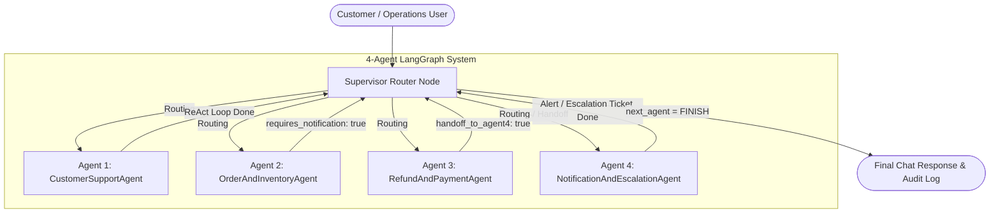

# AETHER INDIA — Autonomous AI Business Operations Agent

**Domain:** Luxury Streetwear & Apparel E-Commerce Platform
**Architecture:** 4-Agent LangGraph Multi-Agent System | SQLite + ChromaDB RAG

---

## ⚡ Quick Start (Windows 11)

> **No terminal needed. Just double-click.**

| File | What it does |
|------|-------------|
| `SETUP.bat` | ▶ Run **once** on a new PC — installs everything automatically |
| `START.bat` | ▶ Double-click every time to launch the project |
| `STOP.bat` | ▶ Double-click to stop all servers |

### Step-by-step for first time:

**1. Install prerequisites** (free, one-time):
- [Python 3.11+](https://www.python.org/downloads/) — ✅ check **"Add Python to PATH"**
- [Node.js LTS](https://nodejs.org/) — use all default options
- [Git](https://git-scm.com/download/win) — use all default options

**2. Get a free Gemini API Key:**
- Go to [aistudio.google.com/apikey](https://aistudio.google.com/apikey)
- Click **Create API Key** → copy it

**3. Clone & run:**
```bash
git clone https://github.com/YOUR_USERNAME/aether-india.git
cd aether-india
```
Then double-click **`SETUP.bat`** — it will ask for your API key and install everything.

**4. Every time after that:**
- ▶ Double-click **`START.bat`** → browser opens automatically at `http://localhost:3000`
- ■ Double-click **`STOP.bat`** → stops all servers

---

## 🔑 Demo Credentials

| Role | Email | Password |
|------|-------|----------|
| **Customer** | aarav@customer.com | Demo@1234 |
| **Admin** | admin@aether.in | Demo@1234 |

> 💡 Use the **1-Click Demo Login** buttons on `/login` — no typing needed!

---

## 🌐 Access URLs

| URL | Description |
|-----|-------------|
| `http://localhost:3000` | Customer Storefront |
| `http://localhost:3000/admin` | Admin Operations Dashboard |
| `http://localhost:8000/docs` | FastAPI Swagger API Docs |

---

## 1. System Overview

AETHER INDIA is an autonomous business operations platform built for final-year engineering project demonstration. It combines a high-contrast luxury streetwear storefront with a **4-Agent LangGraph Supervisor multi-agent architecture** that autonomously handles:

- **Product Styling & Brand Knowledge RAG** — Free local embeddings over policy & sizing manuals
- **Live Order Creation, Stock Control & Real-time Cancellation** — BlueDart & Delhivery dispatch
- **Automated ₹ Refunds vs. Human-in-the-Loop Escalation** — Strict ₹5,000 threshold enforcement
- **Operations Head Dashboard** — HITL authorization queue, real-time KPI aggregates, stock matrix

---

## 2. The 4-Agent LangGraph Architecture



### Agent Roles & Tool Roster

**AGENT 1 — `CustomerSupportAgent`**
- Policy Q&A, fit guidance, washing care, and streetwear catalog recommendations
- Tools: `query_brand_knowledge_rag`, `search_and_style_products`

**AGENT 2 — `OrderAndInventoryAgent`**
- Direct order placement from chat, live parcel tracking, stock validation, and cancellation rules
- Tools: `create_new_order`, `check_inventory_and_add_to_cart`, `check_order_status`, `cancel_or_modify_order`

**AGENT 3 — `RefundAndPaymentAgent`**
- Payment verification (UPI/Card), size exchanges with RMA generation, automated refund tier enforcement
- Tools: `check_payment_and_refund_status`, `process_refund_or_exchange` (**₹5,000 Threshold**)

**AGENT 4 — `NotificationAndEscalationAgent`**
- Real-time customer alerts and Human-in-the-Loop ticket generation
- Tools: `send_customer_notification`, `escalate_to_human_admin`

---

## 3. Tech Stack

| Layer | Technology | Cost |
|-------|-----------|------|
| **Frontend** | Next.js 14, TypeScript, Tailwind CSS, Zustand, Framer Motion | 100% Free |
| **Backend** | Python 3.11+, FastAPI, SQLAlchemy, Pydantic v2 | 100% Free |
| **Multi-Agent Core** | LangGraph StateGraph, LangChain | Free (OSS) |
| **LLM** | Google Gemini 2.5 Flash / Groq / OpenAI (configurable) | Free tier available |
| **RAG Vector Store** | ChromaDB + `sentence-transformers/all-MiniLM-L6-v2` | 100% Free / Local |
| **Database** | SQLite with WAL mode & Foreign Keys | 100% Free / Local |

---

## 4. Demo Portals & Seeded Credentials

### 🛍️ Customer Portal (`http://localhost:3000`)
- **Login:** `aarav@customer.com` / `Demo@1234`
- **Address:** Flat 402, Pinnacle Residency, Vijay Nagar, Indore, MP - 452010

**Pre-seeded orders to test every agent:**

| Order | Amount | Status | Tests |
|-------|--------|--------|-------|
| AETH-1001 | ₹1,699 | Processing | Agent 2 — instant cancel / address change |
| AETH-1002 | ₹3,499 | Delivered | Agent 3+4 — auto-refund (≤ ₹5k threshold) |
| AETH-1003 | ₹7,999 | Delivered | Agent 3+4 — HITL escalation (> ₹5k) |
| AETH-1004 | ₹2,999 | In Transit | Agent 2 — live tracking + blocks cancellation |

### 🛡️ Admin Operations Dashboard (`http://localhost:3000/admin`)
- **Login:** `admin@aether.in` / `Demo@1234`
- `/admin` — Revenue KPIs, AI resolved vs escalated ratio
- `/admin/approvals` — **HITL Queue** to approve/reject > ₹5,000 refunds
- `/admin/orders` — Order & carrier tracking management
- `/admin/inventory` — Live size stock matrix with restock controls
- `/admin/agent-logs` — Full multi-agent audit trail

---

## 5. Project Structure

```
aether-india/
├── START.bat              ← One-click launch (double-click this!)
├── STOP.bat               ← One-click stop
├── SETUP.bat              ← One-time setup for new computers
├── _run_backend.bat       ← Backend helper (called by START)
├── _run_frontend.bat      ← Frontend helper (called by START)
├── backend/
│   ├── main.py            ← FastAPI app + all API routes
│   ├── seed.py            ← Database seeder + ChromaDB embeddings
│   ├── rag_engine.py      ← ChromaDB RAG integration
│   ├── requirements.txt   ← Python dependencies
│   ├── .env.example       ← Copy to .env and add your API key
│   ├── agents/
│   │   ├── agent.py       ← 4-Agent LangGraph supervisor system
│   │   └── tools.py       ← All agent tools (order, refund, RAG, etc.)
│   ├── api/
│   │   ├── auth.py        ← JWT authentication endpoints
│   │   └── schemas.py     ← Pydantic request/response models
│   ├── db/
│   │   ├── models.py      ← SQLAlchemy ORM models
│   │   └── database.py    ← DB session and engine
│   └── knowledge_base/    ← Markdown docs indexed into ChromaDB
│       ├── return_policy.md
│       ├── shipping_sla.md
│       ├── size_and_fit_guide.md
│       └── fabric_care_manual.md
└── frontend/
    └── src/
        ├── app/           ← Next.js App Router pages
        │   ├── page.tsx           ← Storefront homepage
        │   ├── shop/              ← Product listing
        │   ├── cart/              ← Shopping cart + checkout
        │   ├── orders/            ← Order history
        │   ├── login/             ← Auth (1-click demo login)
        │   ├── notifications/     ← Customer bell drawer
        │   └── admin/             ← Admin dashboard suite
        └── components/
            └── chat/AgentChatDrawer.tsx  ← AI concierge chat UI
```

---

## 6. Demo Walkthrough (For Evaluators)

### Demo 1 — Storefront UI Order
1. Go to `http://localhost:3000`
2. Select size `L` on the *AETHER 480GSM Boxy Hoodie* → **Add to Cart**
3. Go to `/cart`, choose UPI → **Place Order**
4. Order instantly created in SQLite and visible on `/orders`

### Demo 2 — Order via AI Chat (Agent 2)
1. Click the **AI Concierge** button (bottom-right)
2. Type: *"Buy the Vintage Acid-Wash Oversized Graphic Tee in size M using UPI"*
3. Watch the execution trace: `Supervisor → OrderAndInventoryAgent → create_new_order`

### Demo 3 — Auto Refund ≤ ₹5,000 (Agent 3 + 4)
1. In chat: *"I want to return order AETH-1002"*
2. AI auto-approves ₹3,499 refund and notifies customer via bell drawer

### Demo 4 — HITL Escalation > ₹5,000 (Agent 3 + 4)
1. In chat: *"I want a refund for my Gore-Tex jacket order AETH-1003"*
2. AI escalates ₹7,999 (exceeds threshold) → creates admin ticket
3. Switch to `http://localhost:3000/admin/approvals`
4. Click **"Approve & Issue ₹7,999 Refund"** — status changes + notification sent

---

## 7. Environment Configuration

Copy `backend/.env.example` to `backend/.env` and configure:

```env
# Choose your LLM provider: "gemini" | "groq" | "openai"
LLM_PROVIDER=gemini

# Google Gemini (FREE tier) — https://aistudio.google.com/apikey
GOOGLE_API_KEY=your_key_here
GEMINI_MODEL=gemini-2.5-flash

# OR Groq (FREE tier) — https://console.groq.com/keys
GROQ_API_KEY=your_key_here
GROQ_MODEL=llama-3.3-70b-versatile
```

> **Note:** The `SETUP.bat` will prompt you to enter your API key automatically.

---

## 8. Manual Run (Command Line)

If you prefer the terminal over bat files:

```powershell
# Terminal 1 — Backend
cd backend
.\venv\Scripts\python.exe -m uvicorn main:app --host 127.0.0.1 --port 8000 --reload

# Terminal 2 — Frontend
cd frontend
npm run dev
```

---

## License

Built for academic demonstration purposes. All product data, orders, and credentials are seeded demo data.
